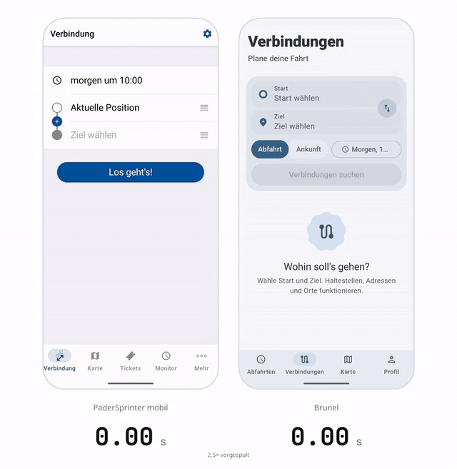
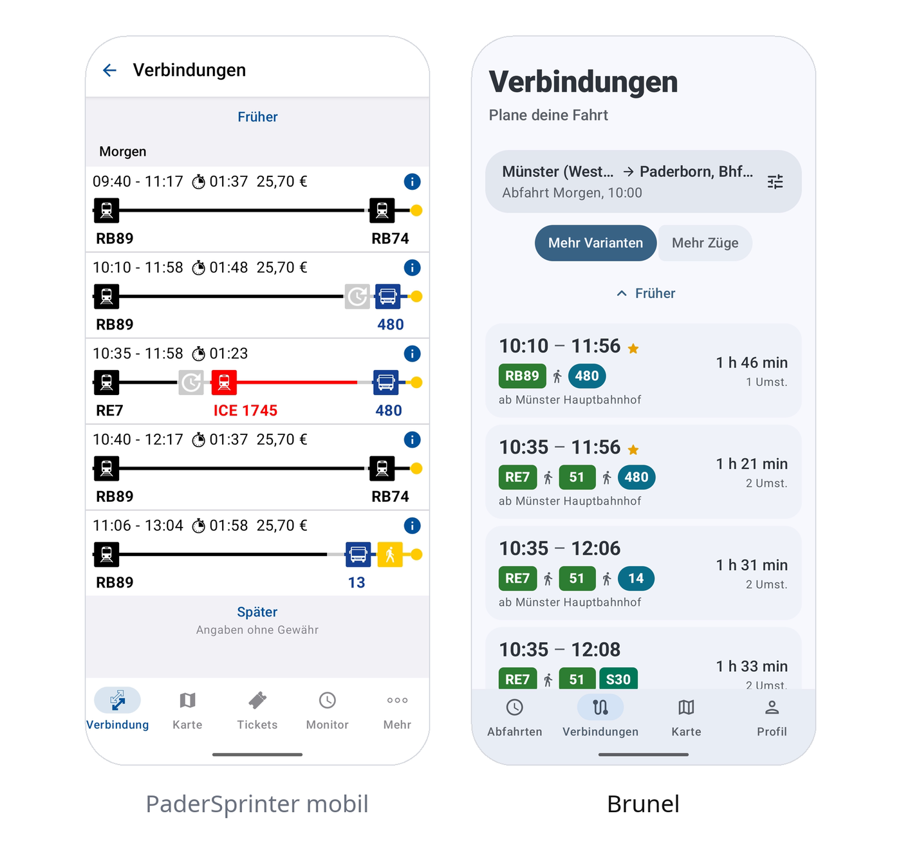
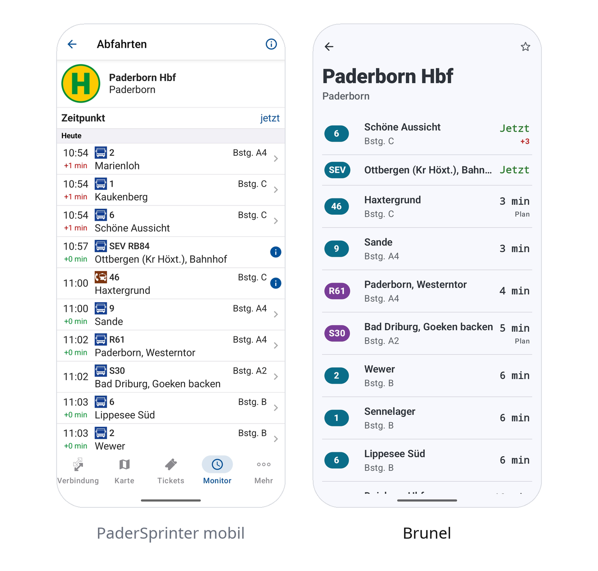

<div align="center">


# PaderBrunel

**A modern Android client for the PaderSprinter timetable**

Kotlin · Jetpack Compose · Material 3 Expressive


</div>

---

<div align="center">



<sub>Same phone, same route (Münster Hbf to Paderborn Kasseler Tor, Monday 10:00), one run each, started on the same tap. Brunel shows the on-device timetable first and reconciles with live data right after. <a href="docs/media/brunel-vs-padersprinter.mp4">Full video</a></sub>

</div>

### Side by side

<table>
<tr>
<td align="center"><br><sub>Verbindungen: Münster Hbf to Paderborn Kasseler Tor, Monday 10:00</sub></td>
<td align="center"><br><sub>Abfahrten: stop board of Paderborn Hbf</sub></td>
</tr>
</table>

---

The app is called Brunel. It talks to the ivanto SRS backend of PaderSprinter, the same one the original app uses, and the UI is German.

## Features

- **Abfahrten.** Live departures at the stops around you.
- **Verbindungen.** Trip search from stop or address to stop or address, ranked by realtime. A delayed train counts at the time it really leaves.
- **Meine Fahrt.** Saved trips with a live view, broken-transfer warnings, and a button to swap any ride that has not started for another connection.
- **Fahrtbegleitung.** Spoken announcements through headphones while you ride.
- **Karte.** Stops on an OpenStreetMap map with the departures of each platform.
- **Störungen.** Disruptions grouped by notice, and the network maps as PDFs.

## Project layout

This repository contains only the Brunel Android app.

- `app/` contains the app and its tests.
- `assets/` contains the app icon.
- `docs/` contains the connection-search plan.
- `tools/` contains the app's API checks and UI test helpers.

## Build

```sh
export JAVA_HOME=~/.local/share/mise/installs/java/temurin-21
./gradlew :app:installDebug        # needs SDK platform android-37.0
./gradlew :app:testDebugUnitTest
```

## How it works

Requests go to `https://service.ivanto.de/srs/api/v1/` with the tenant and app identifiers of the original app (`SrsApi.kt`). Ticketing, login, and push are not used.

- **Trip search** (`TripSearch.kt`) asks the own backend once, from the real start to the real destination, with the minimum change time and the most changes from the settings. The backend (`backend/`) plans with Transitous, adds up to four ways to reach each main train (feeders, staggered by when to leave) and, for departures, other onward buses, and replaces "one stop by bus, then wait" with a walk. When the backend fails, the app falls back to pairs of nearby stops.
- **Ranking** keeps a train only when its best way is not beaten by another (leaves later and arrives no later, arrives clearly earlier for leaving a few minutes earlier, or changes less for nothing). The list shows either up to four ways per train ("Mehr Varianten") or more trains with the best way each ("Mehr Züge").
- **Saved trips** (`LiveTrip.kt`) refresh realtime data per leg and flag transfers that no longer work.
- **Settings** under Profil, Einstellungen set the search style, the minimum transfer time, and the maximum number of changes.

## Routing benchmark

`tools/bench/run.sh` runs 208 searches (Paderborn, the region around it, Cologne; weekday, Saturday, Sunday; morning to night; departure and arrival; 3, 5, and 8 minutes to change) through a local backend and the app's ranking. Router answers are recorded on disk and replayed, so reruns cost Transitous nothing; new ones go out one a second. `tools/bench/reference.py` fetches the router's own answer per search, and `tools/bench/report.py` writes `docs/bench-routing.html`.

## License

[The Unlicense](LICENSE). Public domain, everyone may do anything with it.

## Disclaimer

PaderBrunel is an unofficial project. It is not affiliated with PaderSprinter, Nahverkehrsverbund Paderborn/Höxter, or ivanto.
