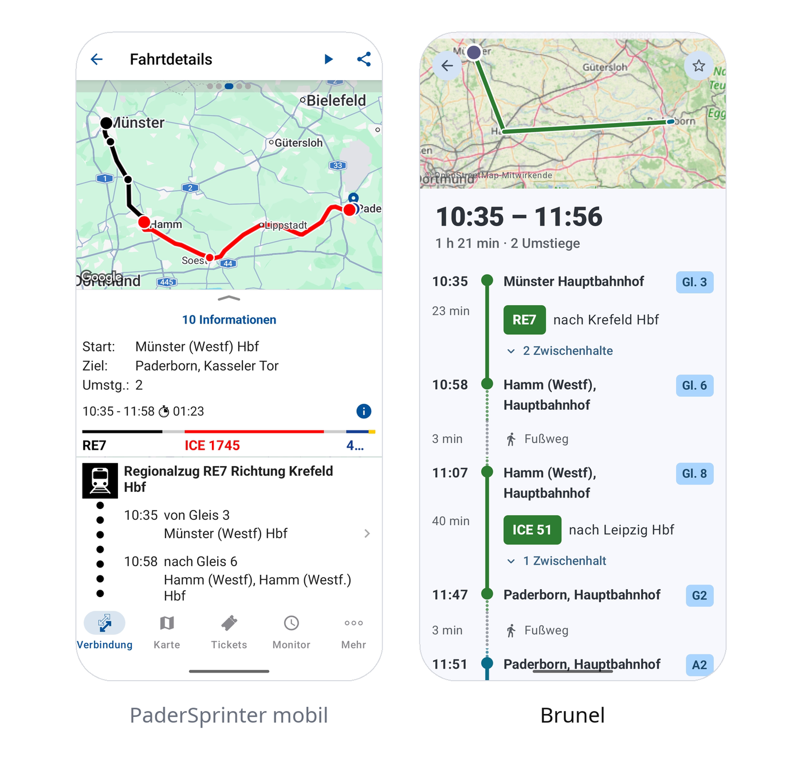
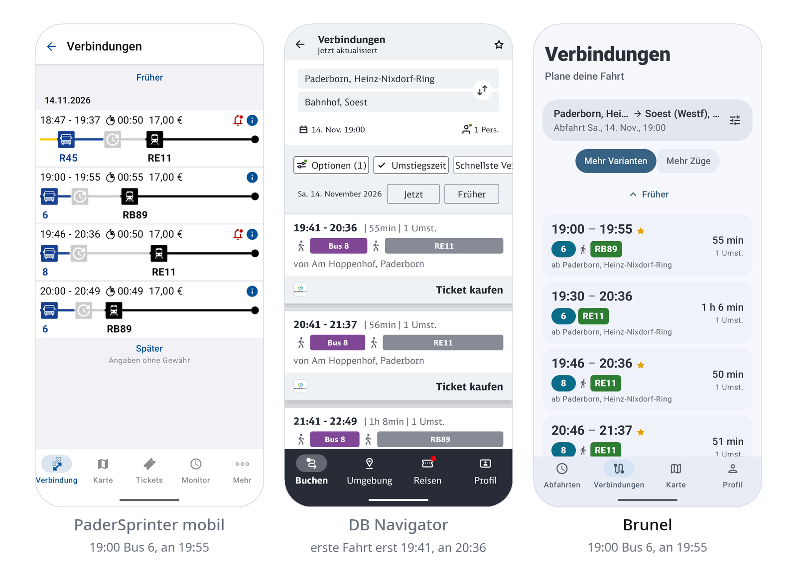
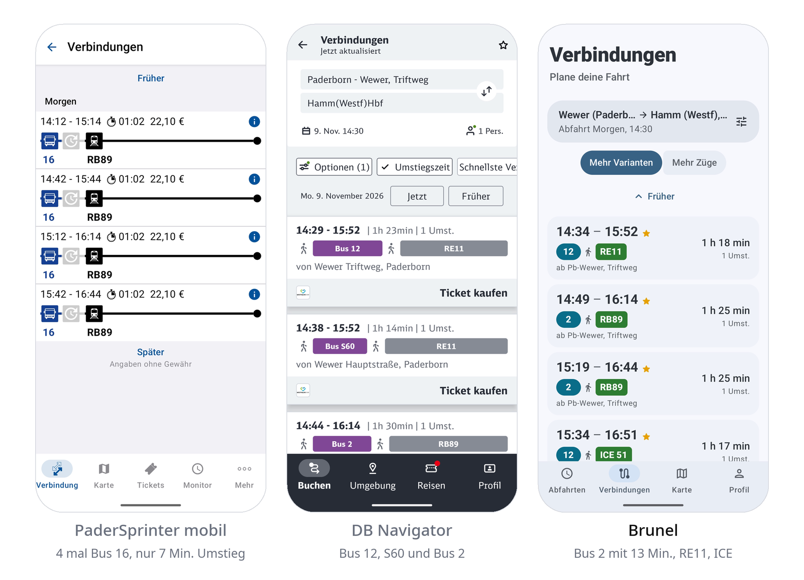
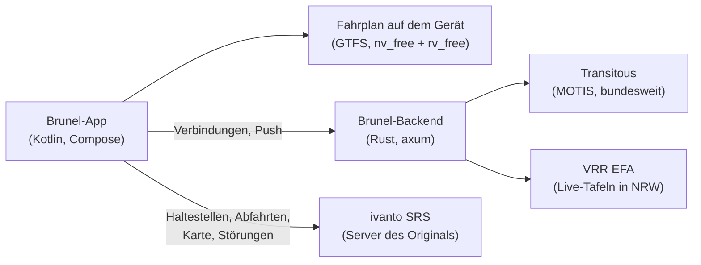

<div align="center">


# PaderBrunel

**Schnellere, schönere und klügere Verbindungen für Paderborn. Ein Ersatz für die PaderSprinter-App.**

Kotlin · Jetpack Compose · Material 3 Expressive · Rust


</div>

---

<div align="center">


<sub>Dasselbe Handy, dieselbe Strecke (Münster Hbf nach Paderborn Kasseler Tor, Montag 10:00), je ein Durchlauf, gestartet mit demselben Tipp. Brunel zeigt zuerst den Fahrplan auf dem Gerät und gleicht gleich danach live ab. <a href="docs/media/brunel-vs-padersprinter.mp4">Ganzes Video</a></sub>

</div>

<table width="100%">
<tr>
<td width="33%" align="center"></td>
<td width="33%" align="center"></td>
<td width="33%" align="center"></td>
</tr>
<tr>
<td width="33%" align="center"><sub>Verbindungen</sub></td>
<td width="33%" align="center"><sub>Fahrtdetails</sub></td>
<td width="33%" align="center"><sub>Abfahrten</sub></td>
</tr>
</table>

---

## Warum Brunel?

**Bessere Verbindungen.** Der Suchalgorithmus ist der Kern der App. Er bietet Busverbindungen an, die Sinn ergeben, mit mehr Varianten und mehr Einstellmöglichkeiten:

- **Mindest-Umstiegszeit** (0, 3, 5, 8 oder 10 Minuten). Knappere Verbindungen verschwinden aus der Liste.
- **Mehrere Wege zu jedem Zug**, zeitversetzt, damit du wählen kannst, wann du losgehst („Mehr Varianten“), oder mehr Züge mit je dem besten Weg („Mehr Züge“).
- **Suchstil** Schnell, Ausgewogen oder Entspannt und eine **Höchstzahl an Umstiegen**.
- Die Liste zeigt, wenn es so viele gibt, mindestens acht Verbindungen.

**Schneller und schöner.** Die Oberfläche ist komplett in Jetpack Compose gebaut. Die erste Liste kommt sofort aus dem Fahrplan auf dem Gerät, danach folgen die Live-Daten.

**Alle Live-Daten bleiben.** Verspätungen und Ausfälle in Echtzeit (auch per Push), Abfahrten, Karte, Störungen und Liniennetzpläne. Brunel kann dasselbe wie die PaderSprinter-App, nur ohne Ticketkauf.


## Beispiele aus Paderborn

Zwei echte Suchen auf demselben Handy, in allen drei Apps. Der DB Navigator und Brunel waren auf 10 Minuten Mindest-Umstiegszeit gestellt. Jede der beiden anderen Apps hat in je einem Beispiel eine Schwäche.

**Heinz-Nixdorf-Ring nach Soest, Samstag 19:00.** Der DB Navigator zeigt als erste Fahrt 19:41 mit Ankunft 20:36. Die Fahrt um 19:00 mit Bus 6 und RB89 (13 Minuten Umstieg, Ankunft 19:55) fehlt dort. Brunel und PaderSprinter zeigen sie.



**Triftweg (Wewer) nach Hamm Hbf, Montag 14:30.** PaderSprinter bietet viermal denselben Bus 16 mit nur 7 Minuten Umstieg zum RB89 an. Der DB Navigator und Brunel finden Bus 2 mit 13 Minuten und weitere Verbindungen.



<sub>Stand der Aufnahmen: 8. November 2026. Die Verbindungen gelten für den jeweils genannten Tag.</sub>

---

## Über das Projekt

Brunel ist ein Hobbyprojekt, das ich hauptsächlich für mich gebaut habe. Ich finde die PaderSprinter-App nicht schön und langsam, und ich wollte genau deshalb eine bessere.

Ich selbst bin Backend-Entwickler und bin nicht wirklich gut, wenn es um UI/UX geht. Den Routing-Algorithmus habe ich selbst entworfen. Der Rest, vor allem UI/UX, ist mit Claude gebaut. Das sage ich offen. Ich baue es zum Spaß, weil ich diese App haben wollte.

---

## Wie es technisch zusammenhängt



**Brunel-Backend** (`backend/`, ein Rust-Dienst mit axum). Es ist eine kleine, zwischengespeicherte Schicht vor deutschen Fahrplandaten:

- **Fahrplan und Suche** kommen von [Transitous](https://transitous.org) (eine offene MOTIS-Instanz mit bundesweiten Daten): Routing, Haltestellensuche, Abfahrten und der Streckenverlauf jeder Fahrt. Das Backend dünnt den Verlauf auf etwa 25 m aus (bei sechs Verbindungen 2,5 KB statt 45 KB).
- **Live-Daten** kommen aus den Abfahrts- und Ankunftstafeln an den Haltestellen jeder Teilstrecke: [VRR/DELFI-EFA](https://efa.vrr.de) in NRW, Transitous außerhalb. Die Zeiten im Fahrplan-Frame bleiben reiner Fahrplan, die Verspätungen kommen in einem zweiten Frame hinterher.
- **Push.** `/v1/watch` schickt Verspätungsänderungen per Server-Sent Events. Pro Haltestelle fragt ein gemeinsamer Poller alle 20 Sekunden ab, egal wie viele Handys sie beobachten. Die Handys fragen nie selbst nach.
- **Robust gegen die Quellen.** Transitous antwortet oft in 0,2 s und hängt manchmal 15 bis 30 s. Hängt die erste Anfrage länger als eine Sekunde, geht eine zweite hinterher, und die schnellere gewinnt. Antworten werden zwischengespeichert, mit ETag und Kompression ausgeliefert.
- **Eigene Planung.** Pro Haupt-Zug werden bis zu vier Wege dorthin angeboten (Zubringer, nach Abfahrtszeit gestaffelt), für Abfahrten weitere Anschlussbusse, und „eine Haltestelle Bus, dann warten“ wird zu einem Fußweg.

**Fahrplan auf dem Gerät.** In `app/src/main/assets/timetables` liegen die Fahrpläne der Region je Tag (aus den [gtfs.de](https://gtfs.de)-Feeds `nv_free` und `rv_free`, DELFI e.V., CC BY 4.0). Der lokale Planer (`LocalPlanner.kt`) rechnet damit die erste Liste, ohne Netz. Für Tage außerhalb der mitgelieferten Fahrpläne baut die App sie notfalls selbst aus den Abfahrtstafeln nach, aber nur im WLAN und während sie lädt.

**ivanto SRS** (der Server der Original-App). Haltestellensuche, Haltestellen in der Nähe, Karte, Abfahrtstafeln, Störungen, Liniennetzpläne und die Bluetooth-Daten für die Fahrtbegleitung kommen weiter von dort, mit den Kennungen der Original-App (`SrsApi.kt`). Ticketkauf, Login und Push der Original-App werden nicht benutzt.

### Die Suche im Detail

- **Verbindungssuche** (`TripSearch.kt`) fragt das eigene Backend einmal, vom echten Start zum echten Ziel, mit der kleinsten Umsteigezeit und der Höchstzahl an Umstiegen aus den Einstellungen. Fällt das Backend aus, fällt die App auf Paare nahegelegener Haltestellen zurück.
- **Rangfolge.** Ein Zug bleibt nur, wenn sein bester Weg nicht von einem anderen geschlagen wird (fährt später und kommt nicht später an, kommt deutlich früher an für ein paar Minuten früheres Losfahren, oder hat weniger Umstiege ohne Nachteil).
- **Zwischenspeicher.** Antworten werden auf dem Gerät zwischengespeichert (im Speicher 15 Minuten, auf der Platte bis zu einem Tag), damit eine wiederholte Suche sofort da ist. Strecken, die du um diese Zeit oft suchst, lädt die App vorab.
- **Gespeicherte Fahrten** (`LiveTrip.kt`) aktualisieren die Echtzeitdaten pro Teilstrecke und melden Anschlüsse, die nicht mehr klappen.
- **Einstellungen** unter Profil, Einstellungen: Suchstil, kleinste Umsteigezeit, Höchstzahl der Umstiege, Ergebnisliste.

### Projektaufbau

- `app/` die Android-App und ihre Tests.
- `backend/` das Rust-Backend und seine Tests.
- `assets/` das App-Icon.
- `docs/` Pläne, der Routing-Benchmark und die Bilder und Videos dieser README.
- `tools/` API-Prüfungen, UI-Testhelfer und der Benchmark.

### Bauen

App:

```sh
export JAVA_HOME=~/.local/share/mise/installs/java/temurin-21
./gradlew :app:installDebug        # braucht SDK-Plattform android-37.0
./gradlew :app:testDebugUnitTest
```

Die Release-Version spricht standardmäßig mit `https://brunel.janosch-bl.de`, die Debug-Version mit `http://127.0.0.1:8099`. Mit `-Pbrunel.backend=<URL>` nimmst du ein anderes Backend.

Backend:

```sh
cd backend
cargo test
BIND=127.0.0.1:8099 cargo run --release
```

Für einen Server mit älterer glibc als dein Rechner baust du statisch: `cargo build --release --target x86_64-unknown-linux-musl`.

### Routing-Benchmark

`tools/bench/run.sh` führt 208 Suchen (Paderborn, die Region darum, Köln; Werktag, Samstag, Sonntag; morgens bis nachts; Abfahrt und Ankunft; 3, 5 und 8 Minuten Umsteigezeit) durch ein lokales Backend und die Rangfolge der App. Die Router-Antworten werden auf der Platte aufgezeichnet und wieder abgespielt, ein erneuter Lauf kostet Transitous also nichts, neue Anfragen gehen im Sekundentakt raus. `tools/bench/reference.py` holt pro Suche die eigene Antwort des Routers, `tools/bench/report.py` schreibt `docs/bench-routing.html`.

---

## Datenquellen und Lizenzen

- Fahrplan und Routing: [Transitous](https://transitous.org) und die dort eingebundenen Feeds, Haltestellen-IDs nach DELFI.
- Fahrplan auf dem Gerät: [gtfs.de](https://gtfs.de), `nv_free` und `rv_free`, DELFI e.V., CC BY 4.0.
- Live-Daten: VRR/DELFI-EFA und Transitous.
- Karte: © OpenStreetMap-Mitwirkende.
- Haltestellen, Abfahrten, Störungen, Liniennetzpläne: ivanto SRS, wie in der Original-App.

## Lizenz

[The Unlicense](LICENSE). Gemeinfrei, jeder darf damit machen, was er will.

## Hinweis

PaderBrunel ist ein inoffizielles Projekt. Es steht in keiner Verbindung zu PaderSprinter, dem Nahverkehrsverbund Paderborn/Höxter, ivanto, Transitous, dem VRR oder der DB.
